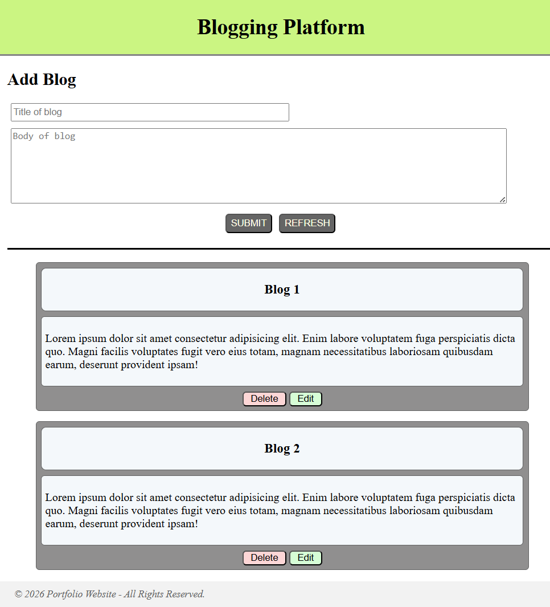
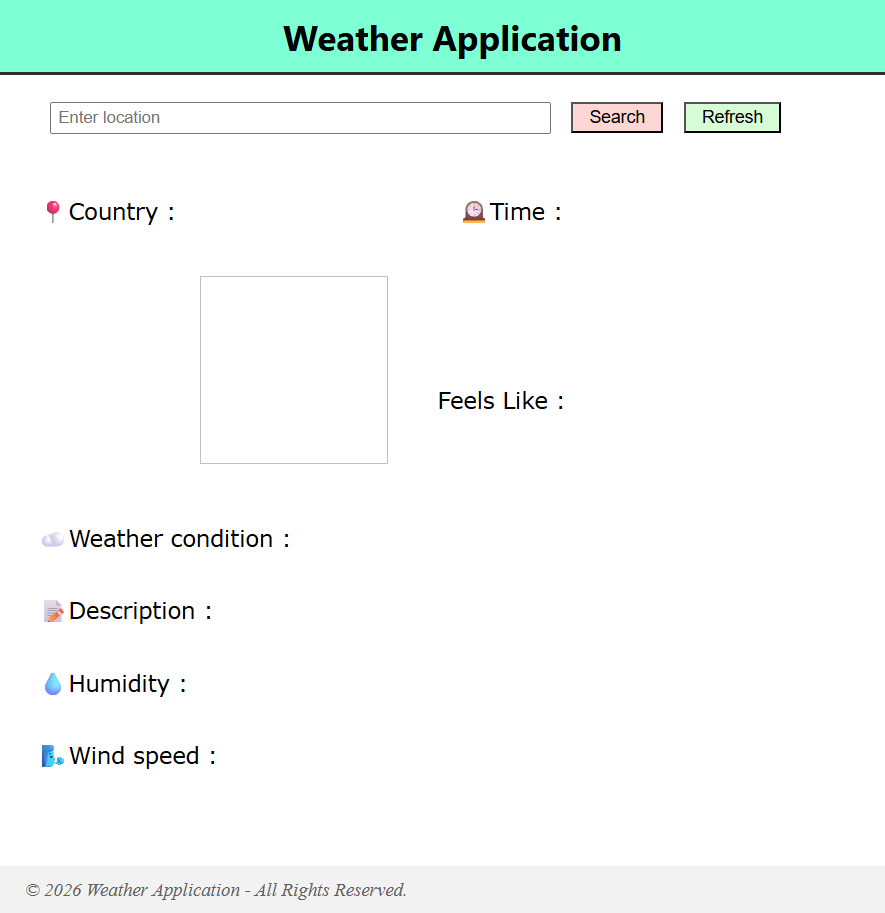
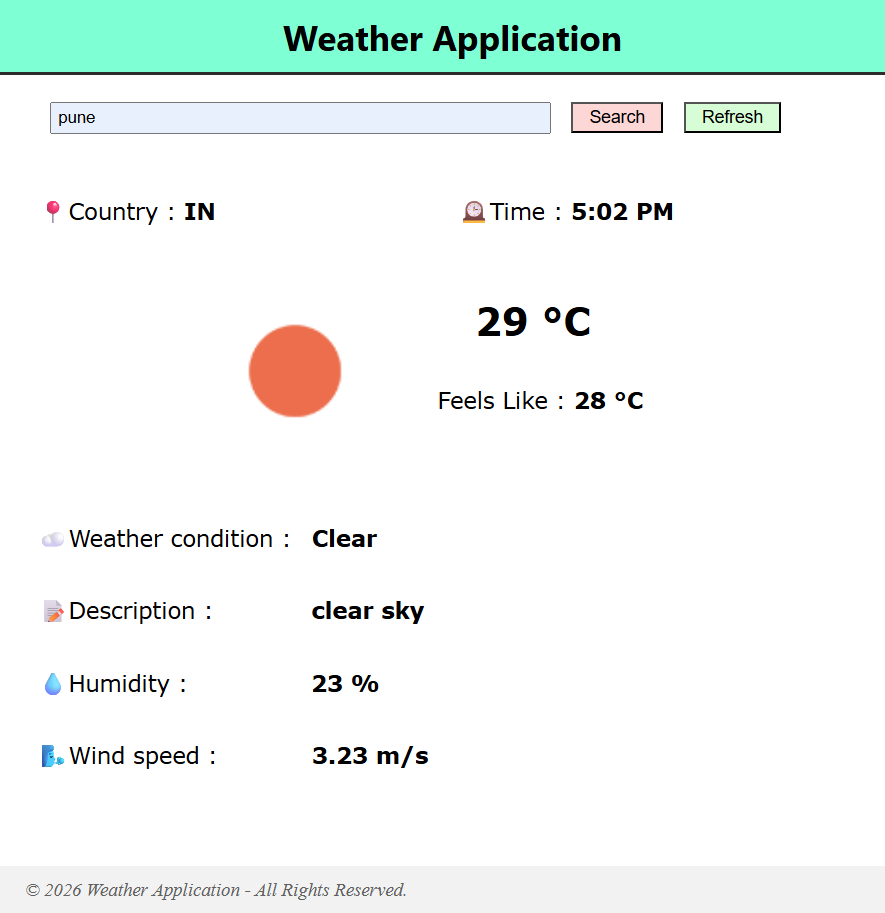
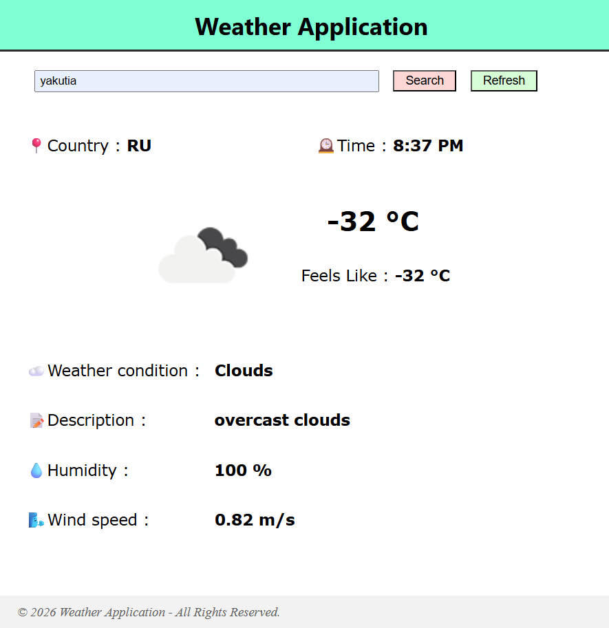

# web-development-internship-tasks
This repository contains a collection of front-end web development tasks completed as part of my Web Development Internship.

The projects demonstrate practical skills in HTML, CSS and JavaScript, focusing on responsive design, clean UI/UX, DOM manipulation and interactive web applications.

Each task is built as an independent mini-project to strengthen core front-end concepts and real-world development practices.

---

## 🚀 Tech Stack

- **HTML5** – Semantic structure 
- **CSS3** – Flexbox, Grid, Media Queries 
- **JavaScript (ES6)** – DOM manipulation, events, basic logic 
- **Git & GitHub** – Version control & hosting 
- **GitHub Pages** – Live project deployment 

---

## 📁 Folder Structure
```
web-development-internship-tasks/
│
├── task1-online-portfolio-website/
├── task2-e-commerce-product-page/
├── task3-navigation-menu/
├── task4-contact-form/
├── task5-blogging-platform/
├── task6-weather-application/
│
├── README.md
├── LICENSE                → (MIT)
└── .gitignore             → (Node)
```
---

## 📌 Task 1 — Online Portfolio Website

### 📖 Description
A personal **portfolio website** built using HTML, CSS, and JavaScript to showcase profile, skills, projects, education and contact information.

The site is responsive and optimized for mobile, tablet and desktop screens.

### 🎯 Skills & Concepts
- Responsive design (Media Queries)
- Flexbox layout
- Section-based UI
- JavaScript interactivity
- Mobile-first approach

### 🗂️ Project Structure
```
task1-online-portfolio-website/
│
├── index.html
├── skill.html
├── project.html
├── about.html
├── education.html
├── contact.html
│
├── css/
│    ├── style.css
│    ├── index.css
│    ├── skill.css
│    ├── project.css
│    ├── about.css
│    ├── education.css
│    └── contact.css
│
├── js/
│    └── main.js
│
└── assets/
    ├── images/           → Section display images
    ├── resume/           → Resume in pdf format
    └── screenshots/      → Page preview screenshot
```
### 🖼️ Preview
- Home Page  


- Skill Page  


- Project Page  


- About Page  


- Education Page  


- contact Page  


---

## 📌 Task 2 — E-commerce Product Page

### 📖 Description
Developed a responsive and visually appealing **E-commerce Product Page** showcasing multiple product categories such as **Electronics**, **Fashion & Lifestyle** and **Home & Living**.

The page focuses on a clean UI, intuitive layout, and responsiveness across different screen sizes using **CSS Grid, Flexbox and Media Queries**. It simulates a real-world online shopping experience with product cards, pricing, category navigation, and call-to-action buttons.

### 🎯 Skills & Concepts
- HTML5 semantic structure  
- CSS Grid & Flexbox  
- Responsive design using media queries  
- UI/UX design principles  
- Category-based product layout  
- Smooth scrolling navigation  
- Button hover interactions  

### 🗂️ Project Structure
```
task2-e-commerce-product-page/
│
├── index.html
├── css/
│    └── style.css
└── assets/
     ├── img/              → Section display images
     └── screenshot/       → Page preview screenshot
```
### 🖼️ Preview
- E-commerce Product Page  


---

## 📌 Task 3 — Navigation Menu Webpage

### 📖 Description
Developed a simple responsive navigation page with internal section links for smooth user scrolling. The page includes sections like Home, About, Services, Contact along with basic UI styling for usability.

### 🎯 Skills & Concepts
- HTML semantic sections
- Navigation bar
- Internal anchor links
- Smooth scrolling using JavaScript
- Basic CSS styling and layout

### 🗂️ Project Structure
```
task3-navigation-menu/
│
├── index.html
├── css/
│    └── style.css
└── assets/
     ├── img/               → Section display images
     └── screenshots/       → Page preview screenshot
```
### 🖼️ Preview

- Navigated Web Page


---

## 📌 Task 4 — HTML Contact Form

### 📖 Description
Developed a basic contact form to practice HTML form components such as:
- Text inputs
- Email & phone fields
- Radio buttons
- Checkboxes
- Date input
- File upload
- Textarea

The form also includes required fields, basic client-side validation and displays submitted data on a separate results page using URL query parsing.

### 🎯 Skills & Concepts
- HTML
- Form elements & attributes
- Client-side validation
- GET method
- Basic input handling

### 🗂️ Project Structure
```
task4-contact-form/
│
├── index.html
├── results.html
└── assets/
     └── screenshots/       → Page preview screenshot
```
### 🖼️ Preview

- Contact Form (Empty)


- Submission Result


---

## 📌 Task 5 — Blogging Platform

### 📖 Description
A mini **blogging platform** where users can:
- Create blog posts
- Edit existing posts
- Delete posts
- Data persists on page refresh

### 🎯 Skills & Concepts
- DOM manipulation
- JavaScript event handling
- CRUD operations
- Local state handling
- UI updates

### 🗂️ Project Structure
```
task5-blogging-platform/
│
├── index.html
├── css/
│    └── style.css
├── js/
│    └── main.js
└── assets/
    └── screenshot/       → Page preview screenshot
```
### 🖼️ Preview
- Home Page  


---

## 📌 Task 6 — Weather Application

### 📖 Description
A **real-time Weather Application** that fetches and displays weather data based on city input using a public API.

The UI is fully responsive and works in full-screen mode.

### 🎯 Skills & Concepts
- API integration
- Fetch API
- Async JavaScript
- Error handling
- Responsive UI

### 🗂️ Project Structure
```
task6-weather-application/
│
├── index.html
├── css/
│    └── style.css
├── js/
│    └── main.js
└── assets/
    └── screenshot/       → Page preview screenshot
```
### 🖼️ Preview
- Weather App (Empty State)



- Weather App (e.g. Pune)



- Weather App (e.g. Yakutsk)



---

### ▶️ How to Run

1. Clone the repository
```
git clone https://github.com/Lokesh-Sapkal/web-development-internship-tasks.git
```
2. Open any task folder
```
cd task2-e-commerce-product-page
```
3. Open index.html in your browser

---

### 👨‍💻 Author
**Lokesh Sapkal**  
Web Development Intern

---

### ⭐ If you like this project, feel free to star the repository!

---

### 📝 License
This project is licensed under the **MIT License** – feel free to use and modify.

---
